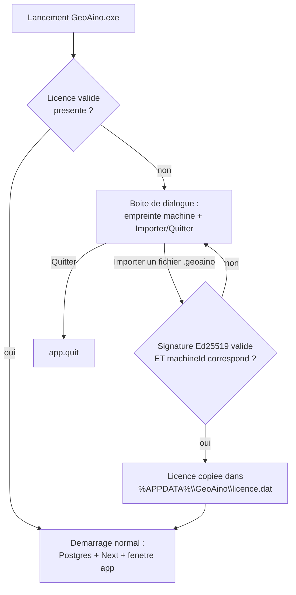

# Clé d'activation pour le bureau autonome GeoAino

Date : 2026-09-13
Statut : approuvé (brainstorming), en attente de plan d'implémentation

## Contexte et objectif

Le bureau autonome GeoAino (`docs/BUREAU-AUTONOME.md`) est distribué/vendu à
des tiers (mairies, cabinets de géomètres) sous forme d'un installateur
Windows autonome (Electron + PostgreSQL/PostGIS portable). Aujourd'hui,
**aucune protection de licence n'existe** : un client en possession de
l'installateur peut l'installer et le dupliquer librement sur autant de
postes qu'il veut, sans limite ni contrôle.

Objectif : ajouter un système de **clé d'activation liée à la machine**,
empêchant qu'une même vente serve à activer plus de postes que prévu, tout
en respectant les contraintes déjà établies du bureau autonome : mono-poste,
fonctionnement 100% hors ligne, pas de nouvelle dépendance serveur/infra.

## Décisions validées (brainstorming)

| Décision | Choix retenu |
| --- | --- |
| Connexion réseau requise pour valider | **Non** — vérification 100% locale, aucun appel réseau jamais |
| Liaison à une machine | **Oui** — une licence n'active qu'UN poste précis |
| Durée de validité | **Perpétuelle** une fois activée (pas d'expiration) |
| Mode de remise de la licence | **Fichier** à importer (`.geoaino`), pas un code tapé à la main |
| Mécanisme cryptographique | **Ed25519 asymétrique** (clé privée chez le vendeur, clé publique embarquée dans l'app) — rejeté : HMAC à secret partagé (extractible du binaire), service de licence tiers (nécessite du réseau) |
| Interface d'activation | **Boîtes de dialogue natives Electron**, cohérent avec le pattern déjà utilisé pour les identifiants admin dans `main.ts` — rejeté : page HTML dédiée (complexité non justifiée pour un écran vu une fois par machine) |

## Architecture générale



La vérification de licence est la **toute première étape** du démarrage
(`demarrerApplication()` dans `desktop/src/main.ts`), avant
`demarrerPostgresPortable()` : inutile de démarrer Postgres/Next si l'app
n'est pas activée. La licence est **revalidée à chaque lancement** (pas
seulement mise en cache après le premier import) — cohérent avec le reste de
l'app, rien n'est jamais fait confiance sans revérification.

## Empreinte machine

Dérivée du `MachineGuid` Windows
(`HKLM\SOFTWARE\Microsoft\Cryptography\MachineGuid`), stable tant que Windows
n'est pas réinstallé sur ce poste. Lu directement via le module `node:` du
registre Windows disponible dans Electron (pas de dépendance à
`wmic`/`powershell`, cohérent avec les contraintes déjà rencontrées lors du
packaging — cf. `docs/BUREAU-AUTONOME.md`). Hashé en SHA-256, dont les 16 premiers octets (128 bits — largement
suffisant pour l'unicité recherchée ici) sont ré-encodés en **base32 Crockford**
(alphabet sans caractères ambigus : pas de `0`/`O` ni `1`/`I`/`L`) et affichés
groupés par blocs de 4 (ex. `A1B2-C3D4-E5F6-G7H8-...`, 26 caractères sur 7
blocs) — assez court pour être transmis par téléphone ou recopié par email
sans erreur, tout en gardant une entropie suffisante pour distinguer deux
machines.

## Format du fichier de licence (`*.geoaino`)

Fichier JSON, remis au client par le vendeur (email, clé USB, etc.) :

```json
{
  "machineId": "A1B2-C3D4-E5F6-G7H8-... (meme forme base32 groupee que celle affichee au client, avec les tirets)",
  "client": "nom du client (informatif, non verifie)",
  "emisLe": "2026-09-13T00:00:00.000Z",
  "signature": "base64 — signature Ed25519 de {machineId, client, emisLe}"
}
```

`machineId` est stocké et comparé sous exactement la même forme groupée
(tirets compris) que celle affichée à l'utilisateur — le vendeur colle
directement ce que le client lui a transmis en argument de
`generer-licence.mjs`, sans reformatage à faire à la main.

Vérification côté app (`desktop/src/licence.ts`, nouveau fichier) :
1. Reconstruire le message canonique à partir de `machineId` + `client` +
   `emisLe`.
2. Vérifier la signature avec la clé publique du vendeur (constante
   `CLE_PUBLIQUE_VENDEUR`, embarquée en dur dans le code source — une clé
   publique n'a pas besoin d'être secrète).
3. Vérifier que `machineId` correspond à l'empreinte de **cette** machine.
4. Les deux conditions doivent être vraies pour considérer la licence valide.

## Composants à créer

| Fichier | Rôle |
| --- | --- |
| `desktop/src/machine-id.ts` | Calcule l'empreinte machine (lecture `MachineGuid` + hash) et sa forme lisible |
| `desktop/src/licence.ts` | Format de licence, vérification de signature (clé publique embarquée), lecture/écriture de `%APPDATA%\GeoAino\licence.dat` |
| `desktop/src/main.ts` (modifié) | `demarrerApplication()` appelle la vérification de licence en tout premier ; boucle de dialogues natifs (empreinte / import / erreur) si absente ou invalide |
| `desktop/scripts/licence/generer-cle-vendeur.mjs` | Outil vendeur, à lancer une seule fois : génère la paire Ed25519, écrit la clé privée localement, affiche la clé publique à coller dans `licence.ts` |
| `desktop/scripts/licence/generer-licence.mjs` | Outil vendeur : `node generer-licence.mjs <machineId> <nomClient>` → produit `licence-<nomClient>.geoaino` signé avec la clé privée locale |
| `desktop/scripts/test-licence.ts` | Test automatisé (génère un keypair de test, vérifie acceptation/rejet — voir Tests) |

## Sécurité de la clé privée vendeur

La clé privée Ed25519 générée par `generer-cle-vendeur.mjs` (fichier
`cle-privee-vendeur.pem`) **ne doit jamais** être committée dans le dépôt ni
embarquée dans l'installateur — elle est le seul secret de tout le système.
`.gitignore` du dépôt est étendu pour exclure `desktop/scripts/licence/*.pem`
et `desktop/scripts/licence/*.geoaino` (les licences générées localement lors
de tests ne doivent pas non plus finir committées par erreur).

**Risque assumé et documenté** : si cette clé privée est perdue ou compromise,
il faut régénérer une nouvelle paire et publier une nouvelle version de l'app
avec la nouvelle clé publique — ce qui invalide **toutes** les licences déjà
émises avec l'ancienne clé (tous les clients existants devraient recevoir une
nouvelle licence). À documenter explicitement dans
`docs/BUREAU-AUTONOME.md` comme limitation connue.

## Interface d'activation (boîtes de dialogue natives)

Dans `main.ts`, avant `demarrerPostgresPortable()` :

1. Si `licence.dat` absent, illisible, ou invalide → `dialog.showMessageBoxSync`
   avec l'empreinte machine lisible + boutons **Importer une licence** /
   **Quitter**.
2. **Importer** → `dialog.showOpenDialogSync` (filtre `*.geoaino`) → tentative
   de vérification :
   - Valide → copie dans `%APPDATA%\GeoAino\licence.dat`, poursuite du
     démarrage normal.
   - Invalide → `dialog.showErrorBox` avec un message **générique** («
     Fichier de licence invalide ou ne correspondant pas à cette machine. »
     — volontairement peu spécifique, pour ne pas indiquer si le problème
     vient de la signature ou de l'empreinte), retour à l'étape 1.
3. **Quitter** → `app.quit()` immédiat, aucun démarrage de Postgres/Next.

## Gestion d'erreurs et limites assumées

- Fichier corrompu / signature invalide / empreinte différente → même message
  générique dans les trois cas (pas d'information exploitable pour
  contourner la vérification).
- **Réinstallation de Windows ou changement de disque** → nouvelle empreinte
  machine → l'ancienne licence ne fonctionne plus sur ce poste → le client
  doit recontacter le vendeur pour une nouvelle licence. Limitation assumée,
  standard pour ce type de protection, à documenter dans
  `docs/BUREAU-AUTONOME.md`.
- **Copie de `licence.dat` vers une autre machine** → refusée par
  construction (empreinte différente) — c'est le comportement recherché.
- **Suppression accidentelle de `licence.dat`** → redemande l'écran
  d'activation ; le client doit réimporter son fichier `.geoaino` d'origine
  (à conserver de son côté, ne pas compter uniquement sur `%APPDATA%`).
- **Pas de révocation** : une fois une licence valide émise et importée, il
  n'existe aucun mécanisme pour la désactiver à distance (cohérent avec le
  choix « 100% hors ligne, perpétuelle »). Limitation assumée.

## Tests

- **Automatisé** (`desktop/scripts/test-licence.ts`, même style que
  `desktop/scripts/test-postgres-manager.ts`) :
  - Génère une paire de clés Ed25519 de test.
  - Signe une licence pour une empreinte de test → vérifie l'acceptation.
  - Falsifie un octet de la signature → vérifie le rejet.
  - Change l'empreinte dans le fichier signé → vérifie le rejet (signature
    ne correspond alors plus au contenu).
  - Empreinte correcte mais machine locale différente (mock) → vérifie le
    rejet.
- **Manuel** (à documenter dans `docs/BUREAU-AUTONOME.md`, section
  vérification manuelle existante) :
  1. Lancer l'app sans `licence.dat` → vérifier l'affichage de la vraie
     empreinte machine.
  2. Générer une vraie licence via `generer-licence.mjs` avec cette
     empreinte.
  3. Importer → vérifier le démarrage normal (Postgres/Next/fenêtre).
  4. Relancer l'app → vérifier l'absence de redemande d'activation.
  5. Copier `licence.dat` sur une autre machine (ou simuler une empreinte
     différente) → vérifier le refus au lancement.

## Hors périmètre (explicitement)

- Licences à durée limitée / renouvellement (choix : perpétuel).
- Activation en ligne / serveur de licence (choix : 100% hors ligne).
- Révocation à distance d'une licence déjà activée.
- Support multi-postes dans un seul fichier de licence (une licence = une
  machine ; plusieurs postes = plusieurs fichiers générés séparément).
